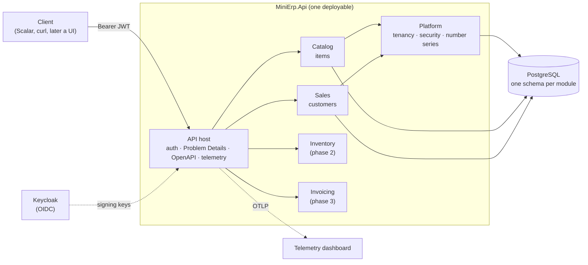

# mini-erp

A multi-tenant ERP backend on .NET 10: **catalog → inventory → sales orders → shipments → invoices → e-invoice submission**, modelled on how Microsoft Dynamics 365 Business Central posts documents and rebuilt from scratch.

> **Status:** phase 1 of 4 is complete: the foundation, authentication and tenant isolation, number series, items and customers. Inventory and sales orders come next ([roadmap](#roadmap)). This README only claims what the code and its tests show.

## What it shows

- **Tenant isolation you can't forget:** several companies share one database. The tenant comes only from the access token; an EF Core query filter adds it to every query and a `SaveChanges` interceptor refuses writes to another tenant's rows. Every endpoint has a test that tries to reach another tenant's data and gets 404.
- **Secure by default:** every endpoint requires an authenticated user with a tenant unless it explicitly opts out; endpoints require *permissions*, and roles map to permissions in one place.
- **No lost updates:** responses carry an `ETag` (PostgreSQL's row version); updates need `If-Match`, and a stale version answers 412 instead of overwriting someone else's change.
- **Correct under concurrency:** document numbers come from one atomic upsert; a test fires 50 parallel requests and gets exactly 50 distinct, consecutive numbers.
- **Module boundaries enforced by tests:** a modular monolith whose architecture tests fail the build when a module reaches into another.
- **Real infrastructure in tests:** integration tests run the real API against PostgreSQL in Docker (Testcontainers), with tokens signed by the tests, so CI needs nothing but Docker.

## Quick start

Requirements: [.NET SDK 10](https://dotnet.microsoft.com/download) and Docker with Linux containers.

```bash
git clone https://github.com/stefanbabic5/mini-erp.git
cd mini-erp
docker compose up -d                   # PostgreSQL, Keycloak, telemetry dashboard
dotnet run --project src/MiniErp.Api   # API on http://localhost:5100, creates the schema on first start
```

Then get a token for a demo user and call the API:

```bash
TOKEN=$(curl -s http://localhost:8080/realms/mini-erp/protocol/openid-connect/token \
  -d grant_type=password -d client_id=mini-erp-dev -d username=alfa.sales -d password=dev-password \
  | sed -E 's/.*"access_token":"([^"]+)".*/\1/')

curl -s -H "Authorization: Bearer $TOKEN" http://localhost:5100/api/platform/me
```

| | |
|---|---|
| API reference (Scalar, paste the token under *Authentication*) | http://localhost:5100/scalar |
| Telemetry dashboard (logs, traces, metrics) | http://localhost:18888 |
| Keycloak admin console (`admin` / `admin`) | http://localhost:8080 |

Demo users, all with password `dev-password`: `alfa.admin`, `alfa.sales`, `alfa.warehouse`, `alfa.finance`, and the same four for tenant `beta`. These credentials exist only in the local development realm.

Run the tests (Docker must be running):

```bash
dotnet test
```

## What works today

| Area | Endpoints | Rules |
|---|---|---|
| **Identity** | `GET /api/platform/me` | JWT from Keycloak; user, tenant, roles and resulting permissions |
| **Number series** | `GET`, `PUT /api/platform/number-series/{code}` (Admin) | per-tenant counters, gaps allowed, never duplicated (BR-09) |
| **Items** | `/api/catalog/items`: list, get, create, update, block, unblock | SKU unique per tenant; price with 2 decimals (BR-10); VAT 20 / 10 / 0 %; blocked, never deleted (BR-11, BR-12) |
| **Customers** | `/api/sales/customers`: list, get, create, update, block, unblock | number from the CUST series; PIB check digit and registration number (BR-15); PIB unique per tenant |
| **Health** | `/health/live`, `/health/ready` | readiness fails while PostgreSQL is unreachable |

Errors are [RFC 9457](https://www.rfc-editor.org/rfc/rfc9457) Problem Details, with field errors for validation and a stable `code` for business conflicts (e.g. `catalog.duplicate_sku`).

## Architecture



- **Modular monolith** ([ADR-0001](docs/adr/0001-modular-monolith.md)): each module owns its PostgreSQL schema, `DbContext` and migrations, and exposes only its registration class; architecture tests enforce it.
- **PostgreSQL + EF Core** ([ADR-0002](docs/adr/0002-postgresql-and-ef-core.md)) with `xmin` as the row version.
- **Multi-tenancy** ([ADR-0003](docs/adr/0003-multi-tenancy.md)): shared tables with a tenant column, query filters for reads, an interceptor for writes.
- **Keycloak** ([ADR-0006](docs/adr/0006-keycloak-for-identity.md)) as identity provider; the API only validates tokens.
- **Free dependencies only** ([ADR-0007](docs/adr/0007-free-dependencies-only.md)); every package and its licence is listed in `Directory.Packages.props`.

## Tests

121 tests, run on every pull request by [GitHub Actions](.github/workflows/ci.yml):

| Project | Tests | What |
|---|---|---|
| `MiniErp.ArchitectureTests` | 9 | module boundaries, checked on the compiled assemblies |
| `MiniErp.IntegrationTests` | 112 | the real API in memory against PostgreSQL in Docker: authentication, the permission matrix, tenant isolation on every endpoint, optimistic concurrency, parallel numbering, validation, health probes |

Tests that prove a business rule carry its id in the name (`BR13_...`, `BR15_...`). Each test works in fresh tenants, so tests never depend on each other's data.

## Documentation

| Document | Contents |
|---|---|
| [Specification](docs/specification.md) | scope, roles and permissions, domain model, business rules BR-01…BR-16, order lifecycle, API conventions, phases |
| [Architecture decisions](docs/adr/README.md) | ten ADRs, each with the rejected alternatives |
| [CLAUDE.md](CLAUDE.md) | working agreements, repository layout, commands and endpoint conventions |

## Roadmap

| Phase | Scope | Status |
|---|---|---|
| 1 | Foundation, auth, tenancy, number series, items, customers | done |
| 2 | Warehouses, append-only inventory ledger, sales orders with stock reservation under concurrency, shipments, idempotency keys | next |
| 3 | Invoices with gapless numbers, transactional outbox, a deliberately flaky e-invoice simulator | planned |
| 4 | Load test with published numbers, row-level security, rate limiting, a small React admin UI | planned |

## License

[MIT](LICENSE)
